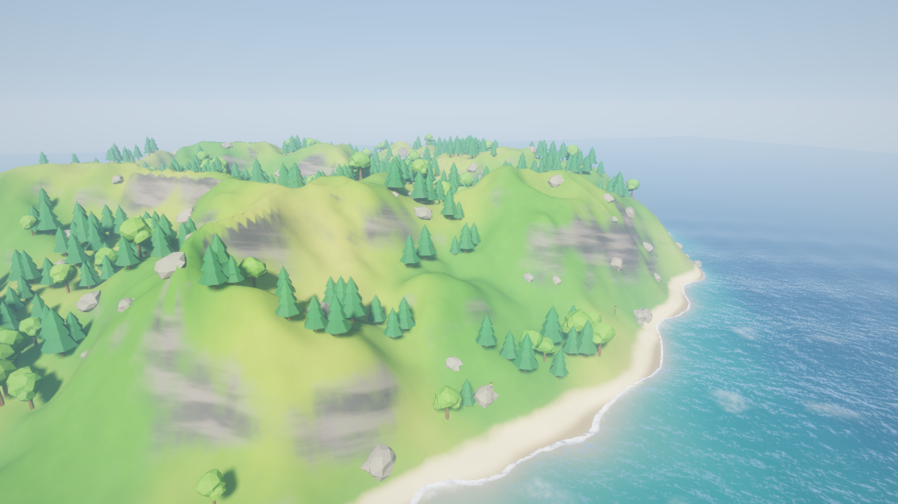
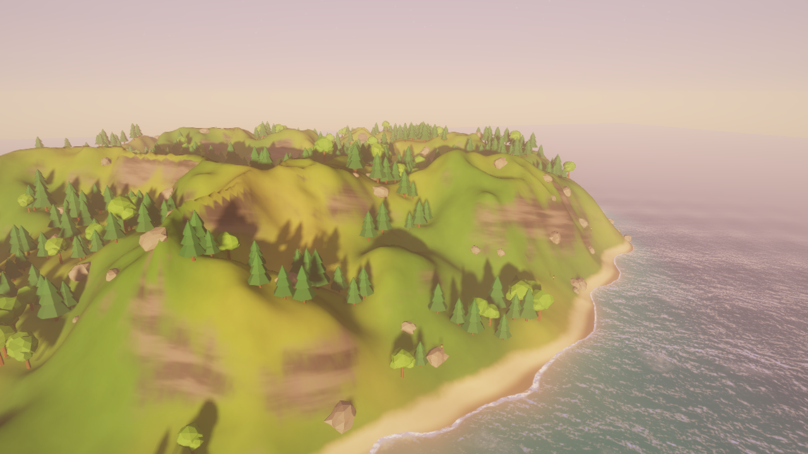
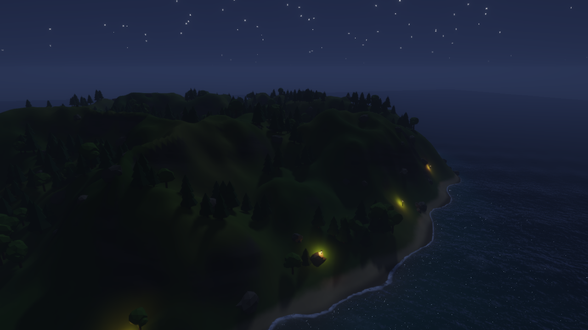
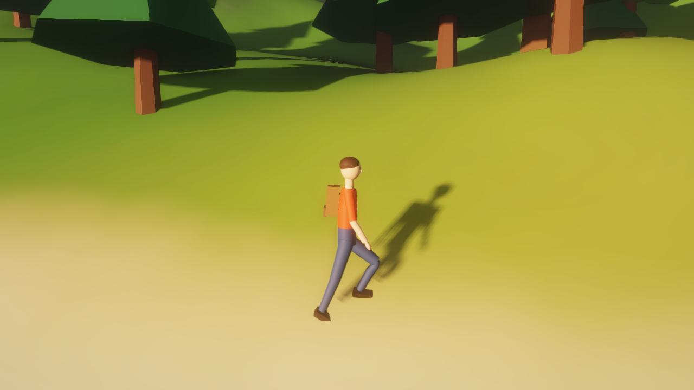
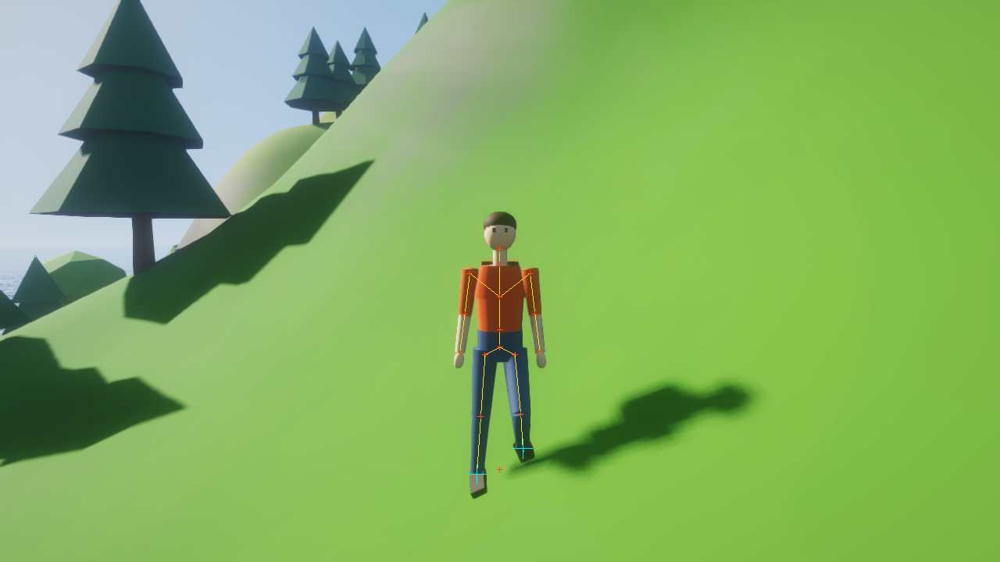
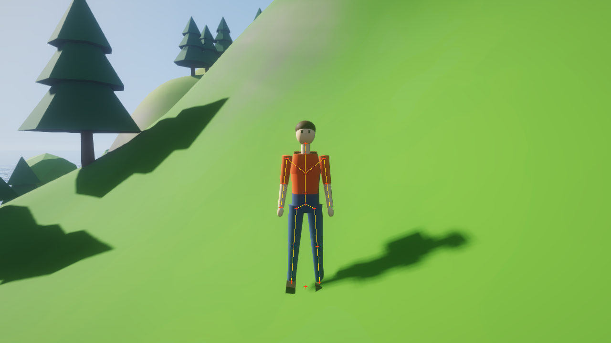

# IsleRender

基于 **C++17 + OpenGL 4.5（DSA）** 从零实现的实时延迟渲染器和第三人称角色演示。场景是一座程序化生成的小岛，带完整昼夜循环；角色使用 GPU 蒙皮，配有动画混合和脚部 IK。

| 白天 | 黄昏 | 夜晚 |
|---|---|---|
|  |  |  |

| 角色行走 | 脚部 IK 开启 | 脚部 IK 关闭 |
|---|---|---|
|  |  |  |

## 渲染管线

```
CSM 阴影(3 级) → G-Buffer → SSAO(半分辨率) → 延迟 PBR 光照 + 程序化天空
→ 前向水面 → Bloom(双重滤波) → ACES 色调映射 → FXAA → 调试线叠加
```

| 模块 | 实现要点 |
|---|---|
| 延迟渲染 | 3 个渲染目标（albedo / 法线+粗糙度 / 金属度+自发光），由深度重建世界坐标 |
| PBR | Cook-Torrance：GGX 法线分布、Smith-Schlick 几何项、Schlick 菲涅尔；半球环境光和天空反射 |
| 级联阴影（CSM） | 实用分割法（对数/均匀混合）；用包围球拟合，避免相机旋转时阴影抖动；按阴影贴图纹素对齐，避免移动时闪烁；法线偏移消除阴影痤疮；3×3 硬件 PCF；级联交界处平滑过渡 |
| SSAO | 法线朝向的半球采样核 + 4×4 旋转噪声，半分辨率计算，带深度感知的模糊 |
| 水面 | 顶点着色器叠加 4 层 Gerstner 波；屏幕空间折射；按水深计算的 Beer 吸收；菲涅尔天空反射；GGX 太阳高光；岸边泡沫 |
| 天空 / 昼夜 | 解析天空（渐变 + 日月盘 + 光晕 + 星空）；太阳、月亮交替作为主光源；夜晚灯笼点光源自动亮起并闪烁 |
| 后处理 | 13 次采样降采样（首级带 Karis 平均，抑制亮点闪烁）+ 帐篷滤波升采样的 Bloom、ACES 色调映射、暗角、FXAA |
| 程序化内容 | 用 FBM 和脊状噪声生成岛屿地形；地表材质（沙滩、草地、岩石、雪）在着色器中按高度和坡度混合；低多边形树木和岩石用实例化绘制 |
| 工程化 | 多机位基准测试与 A/B 开关；着色器 `#include` 预处理和热重载；std140 UBO 统一管理每帧数据；`GL_TIME_ELAPSED` 逐 Pass GPU 计时（延迟回读，不阻塞 CPU）；KHR_debug 调试回调；ImGui 调参面板 |

## 角色动画

| 模块 | 实现要点 |
|---|---|
| 骨架与蒙皮 | 18 根骨骼的层级骨架，由静止姿态计算逆绑定矩阵；网格程序化生成，关节附近的顶点按权重混合父子骨骼，做线性混合蒙皮（LBS）；蒙皮矩阵通过 UBO 传给 GPU，在顶点着色器中蒙皮（G-Buffer 和阴影 Pass 共用） |
| 关键帧动画 | 每个关键帧存各关节的欧拉角，按周期相位用 Catmull-Rom 样条插值，少量关键帧就能得到平滑动作；左右腿共用同一组曲线，相位错开半个周期 |
| 动画混合 | 按速度在待机、走、跑之间做一维混合，再叠加空中姿势；各关节用四元数球面插值（slerp）；走和跑共享归一化相位，并按移动距离推进相位，任何速度下脚都不打滑 |
| 脚部 IK | 两骨骼解析 IK（余弦定理）；按地形高度求脚踝目标点，骨盆按需下沉让低处的脚够得着，落地的脚掌按地面法线倾斜；IK 权重随着地状态平滑过渡 |
| 控制器与相机 | 相对相机方向的移动，带加速度、平滑转身、跳跃、重力和深水阻挡；跟随相机平滑追随目标，并防止穿入地形 |
| 调试 | 骨骼、关节、IK 目标点和速度向量的线框叠加；面板实时显示各动画的混合权重和骨盆下沉量 |

## 性能优化

测试条件：Intel Iris Xe 核显，1280×720，接通电源。用内置基准模式（`--bench`）在 4 个固定机位各统计 120 帧的逐 Pass GPU 耗时，每项优化都可以通过命令行开关单独关闭，在同一次运行里逐项叠加对比，脚本见 [tools/bench_ab.sh](tools/bench_ab.sh)。

### 优化前后（GPU 每帧总耗时，ms）

| 配置 | 总览 | 贴地远眺 | 俯瞰全岛 | 林间 | 三角形 |
|---|---|---|---|---|---|
| 0. 全部关闭 | 8.77 | 8.84 | 11.47 | 7.78 | 1.96M |
| 1. + 地形分块剔除与 LOD | 7.22 | 7.28 | 8.54 | 6.20 | 0.72M |
| 2. + 道具实例剔除 | 8.45\* | 5.96 | 7.07 | 4.50 | 0.50M |
| 3. + 水面预计算细节贴图 | **5.22** | **6.18** | **4.78** | **4.35** | 0.50M |
| **降幅** | **−40%** | **−30%** | **−58%** | **−44%** | **−74%** |

\* 这一格测量时出现过一次瞬时降频：SSAO、Bloom 等与该优化无关的 Pass 同时上涨约 40%，因此这个数值偏高。

### 最终逐 Pass 耗时（ms）

| Pass | 总览 | 贴地远眺 | 俯瞰全岛 | 林间 |
|---|---|---|---|---|
| Shadow maps（3 级联） | 2.02 | 2.39 | 1.10 | 1.97 |
| G-buffer | 1.47 | 2.24 | 1.94 | 0.89 |
| SSAO | 0.36 | 0.46 | 0.34 | 0.38 |
| Lighting | 0.42 | 0.49 | 0.29 | 0.42 |
| Water | 0.58 | 0.24 | 0.75 | 0.32 |
| Bloom | 0.17 | 0.17 | 0.16 | 0.18 |
| Tonemap + FXAA | 0.21 | 0.20 | 0.20 | 0.20 |
| **合计** | **5.22** | **6.18** | **4.78** | **4.35** |

### 各项优化

| 优化 | 做法 | 效果 |
|---|---|---|
| 地形分块 + LOD | 地形切成 12×12 块，每块预生成 4 级索引（网格步长 1/2/4/8）；每个 Pass 用各自的视锥（相机或光源正交视锥）剔除地形块，按到相机的距离选 LOD；块边缘加「裙边」遮住不同 LOD 交界的裂缝，并把裙边下垂深度写入 G-Buffer，光照时据此还原到地表位置，使接缝不可见 | 三角形从 1.96M 降到 0.72M |
| 道具实例剔除 | 树、岩石、灯笼合并成一个网格；每帧对 3 个阴影级联和相机分别做逐实例包围球剔除，相机 Pass 另外剔除屏幕上小于 1.5 像素的物体；结果写入持久映射的三重环形缓冲（fence 同步，CPU 不会覆盖 GPU 正在读的数据），再用 `glDrawElementsInstancedBaseInstance` 绘制 | 阴影 Pass 耗时下降约 35–55% |
| 水面细节贴图 | 启动时在 CPU 上生成一张可平铺的 fBm 坡度/高度贴图，水面着色器里每像素约 28 次噪声计算换成 2 次纹理采样 | 俯瞰全岛时水面 Pass 从 3.08 降到 0.75 ms |

### 实测中发现的两个驱动问题

- **GPU 剔除反而更慢。** 我实现了 compute shader 剔除加 `glMultiDrawElementsIndirect`（由 GPU 写入绘制参数），剔除本身只要 0.03 ms，但在 Iris Xe 上阴影 Pass 比 CPU 剔除慢 2–3 倍（3.3–5.3 ms 对 1.1–2.4 ms），GPU 总耗时 7.0–9.3 ms 对 4.4–6.2 ms。因此默认使用 CPU 剔除，GPU 路径保留为 `--gpucull`，可以在面板里实时切换对比。
- **`glMultiDrawElements` 的 CPU 开销与索引数成正比。** 关闭 LOD 时，用它提交地形每帧要花约 34 ms CPU 时间，改成逐块调用 `glDrawRangeElements` 并显式给出顶点范围后降到约 2 ms。draw call 数虽然从 25 增加到约 260，CPU 提交时间反而更低（开 LOD 时，4 个机位中有 3 个从 2.3–4.1 ms 降到约 1.9 ms；林间机位那次测得 4.8 ms，属于单次波动）。

### 测量方法

- GPU 计时用 `GL_TIME_ELAPSED` 查询，延迟回读，不阻塞流水线。
- CPU 提交时间单独测量：每帧先 `glFinish` 清空队列再计时，避免把 GPU 反压算进去；这部分帧不计入 GPU 统计，因为核显空闲时会降频。
- 电池供电时核显降频，同一份代码的 GPU 耗时波动可达 2 倍，所以以上数据都在接通电源时测得。

复现：

```bash
bash tools/bench_ab.sh
```

运行 `IsleRender.exe --help` 可以查看全部参数，包括 `--nolod`、`--nocull`、`--gpucull`、`--oldwater`、`--multidraw` 等 A/B 开关，以及模拟角色移动、设置出生点、显示骨骼、关闭 IK 等离屏参数。

## 构建（Windows + MSYS2 MinGW64）

```bash
pacman -S mingw-w64-x86_64-{gcc,cmake,ninja,glfw,glew,glm,stb}
cmake -S . -B build -G Ninja -DCMAKE_BUILD_TYPE=Release
cmake --build build
./build/IsleRender.exe
```

Dear ImGui 以源码形式放在 `third_party/imgui`（v1.91.9）。

## 操作

| 输入 | 功能 |
|---|---|
| WASD | 移动角色（相对相机方向） |
| Shift | 奔跑 |
| 空格 | 跳跃 |
| 左键 / 右键拖动 | 环绕相机 |
| 滚轮 | 缩放 |
| F2 | 切换跟随相机 / 自由相机（自由模式下 WASD/QE 移动相机，中键平移） |
| F1 | 显示 / 隐藏面板 |
| F5 | 重新加载所有着色器 |
| F12 | 截图 |

面板里可以切换调试视图（Albedo / 法线 / 粗糙度 / SSAO / 阴影级联 / 深度）、线框模式和骨骼叠加，并调整渲染参数和角色参数（速度、步幅、IK 开关）。

## 目录结构

```
src/core     路径与文件 IO（支持中文路径）、调试线结构
src/gfx      Shader / Mesh / SkinnedMesh / GPU 计时等 OpenGL 封装
src/anim     骨架、关键帧动画、两骨骼 IK、角色控制器
src/scene    相机、视锥、噪声、地形与地形 LOD、程序化模型、世界与昼夜
src/render   延迟渲染器、道具剔除与实例化绘制、调试线渲染
tools        A/B 基准测试脚本
assets/shaders  GLSL 着色器
```

## 兼容性说明

蒙皮的骨骼索引以浮点形式存入顶点属性，再在着色器中转换为整数。原因是部分 Intel Windows 驱动在 DSA 接口 `glVertexArrayAttribIFormat` 下无法正确传递整数顶点属性，实测会导致蒙皮网格消失。
